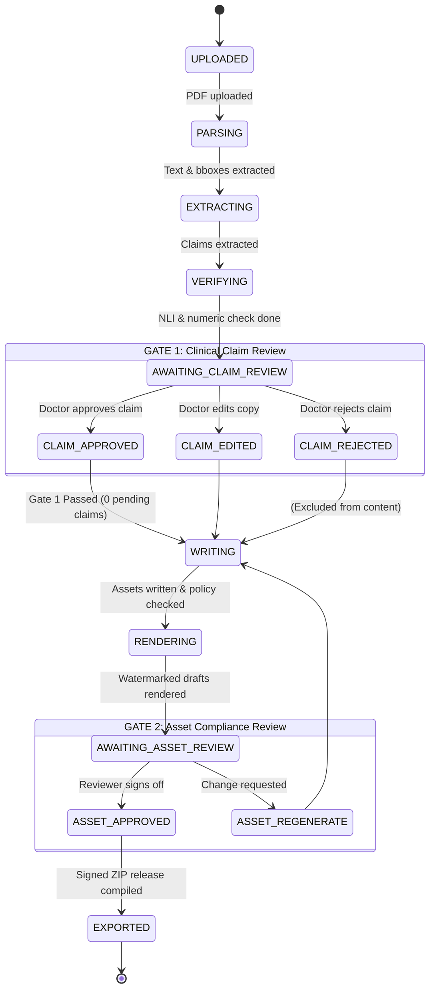
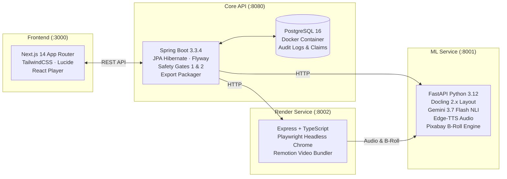

# 🛡️ SteerProof: Clinical Metabolic Verification & Instagram Publishing Pipeline

[](https://opensource.org/licenses/Apache-2.0)
[](https://openjdk.org/projects/jdk/21/)
[](https://spring.io/projects/spring-boot)
[](https://www.python.org/)
[](https://fastapi.tiangolo.com/)
[](https://nextjs.org/)
[](https://www.remotion.dev/)
[](https://playwright.dev/)
[](https://www.postgresql.org/)
[](#-the-100-free-open-stack)

> **A dual-gated, evidence-traceable clinical publishing system that turns dense metabolic health research papers into on-brand Instagram Carousels, Static Posts, AI-voiced Video Reels, and Captions for [Steer](https://steerclub.com).**
>
> *Every single claim on every post links directly to the exact paragraph, page, and coordinate bounding-box in the source clinical trial. Zero content ever reaches the public without explicit, signed clinical review.*

---

## 📖 Table of Contents
1. [Explain Like I'm a Caveman (The Intuition)](#-explain-like-im-a-caveman-the-intuition)
2. [Explain Like I'm a Researcher (The Science & Engine)](#-explain-like-im-a-researcher-the-science--engine)
3. [Visual Walkthrough & UI Showcase](#-visual-walkthrough--ui-showcase)
4. [Dual-Gate Safety Architecture](#-dual-gate-safety-architecture)
5. [Content Output Formats](#-content-output-formats)
6. [System Architecture & Data Flow](#-system-architecture--data-flow)
7. [The 100% Free Open Stack](#-the-100-free-open-stack)
8. [Quickstart: Up & Running in 3 Minutes](#-quickstart-up--running-in-3-minutes)
9. [Verification & Benchmark Results](#-verification--benchmark-results)
10. [Repository Layout](#-repository-layout)
11. [License & Disclosures](#-license--disclosures)

---

## 🪨 Explain Like I'm a Caveman (The Intuition)

### The Problem in Simple Words
```
Caveman sees health advice on internet:
"Eat berry! Melt 10kg fat in 2 days! Guaranteed! Science says so!"
Caveman eats berry. Nothing happens. Caveman gets sick and sad.
Why? Because health influencers lie, cherry-pick words, and exaggerate to get likes.
```

### What SteerProof Does
1. **Reads the Heavy Stone Tablet (The Clinical Paper)**: SteerProof ingests 20-page complex medical research papers written by top scientists.
2. **Finds the Real Facts (The Extractor)**: It pulls out what actually happened to real patients (e.g., *"People taking medicine lost 12% weight over 68 weeks, but weight returned after stopping"*).
3. **The Bullshit Detector (The Verifier)**: It compares the draft against the exact words and numbers in the paper. If an influencer tries to say *"You will lose 50kg forever"*, the alarm rings: **RED / UNSUPPORTED**.
4. **The Doctor Gate (The Stamp)**: A real doctor sits at a computer. They see the claim on the left and the paper highlighted on the right. If the doctor doesn't click **Approve**, the machine physically refuses to print it.
5. **The Instagram Magic (The Publisher)**: Once stamped, it crafts beautiful, calm Instagram carousels, clean statics, and engaging 9:16 vertical video reels with human voiceovers and real footage.

> **In One Sentence**: No snake oil, no fake promises. Just real clinical science, verified by real doctors, transformed into beautiful Instagram posts.

---

## 🔬 Explain Like I'm a Researcher (The Science & Engine)

SteerProof treats medical translation not as a summarisation task, but as a **formal natural language inference (NLI) and compliance verification problem**. 

```
                                CLINICAL TRIAL PDF
                                        │
                                        ▼
                  ┌───────────────────────────────────────────┐
                  │   STAGE 1: Docling Multi-Column Parsing   │
                  │   - Extracts text blocks + page bboxes    │
                  │   - Strict granularity: merge <200 chars  │
                  │   - Bounding box height limit: <= 45%     │
                  └─────────────────────┬─────────────────────┘
                                        │
                                        ▼
                  ┌───────────────────────────────────────────┐
                  │    STAGE 2: Fact Extraction (Gemini)      │
                  │   - scientificClaim + consumerDraft       │
                  │   - Exact quote substring extraction      │
                  │   - Generified drug names (anti-pharma)   │
                  └─────────────────────┬─────────────────────┘
                                        │
                                        ▼
                  ┌───────────────────────────────────────────┐
                  │    STAGE 3: Automated Tri-Layer Verify    │
                  │   1. Rapidfuzz Levenshtein Quote Match    │
                  │   2. Strict Numerical Range Normalisation │
                  │   3. Gemini NLI Semantic Entailment       │
                  │   4. South Asian Population Fit Scoring   │
                  └─────────────────────┬─────────────────────┘
                                        │
                                        ▼
                    ╔═══════════════════════════════════════╗
                    ║ GATE 1: Doctor Claim Review Console   ║
                    ║ - Split UI: Cards + Click-to-Source   ║
                    ║ - PDF coordinate highlight overlay    ║
                    ║ - Explicit Doctor Sign-off Required   ║
                    ╚═══════════════╦═══════════════════════╝
                                    │ Approved Claims Only
                                    ▼
                  ┌───────────────────────────────────────────┐
                  │  STAGE 4: Content Generation & Rendering  │
                  │  - 14 Deterministic Brand/Medical Rules   │
                  │  - Playwright HTML-to-Image (Carousel)    │
                  │  - Remotion React Video Composition (Reel)│
                  │  - Microsoft Edge-TTS Audio Alignment     │
                  └─────────────────────┬─────────────────────┘
                                        │
                                        ▼
                    ╔═══════════════════════════════════════╗
                    ║ GATE 2: Asset Compliance Review       ║
                    ║ - Clickable claim blocks -> drawer    ║
                    ║ - Blocking / Warning policy check     ║
                    ║ - Watermark removal upon approval     ║
                    ╚═══════════════╦═══════════════════════╝
                                    │
                                    ▼
                  ┌───────────────────────────────────────────┐
                  │       STAGE 5: Cryptographic Export       │
                  │   - P-xxxx.zip with verified sources.md   │
                  │   - Immutable review_report.json audit    │
                  └───────────────────────────────────────────┘
```

### 1. Document Parsing & Geometric Granularity
- **Docling 2.x Layout Pipeline**: Ingests multi-column scientific PDFs, detects headings, tables, captions, and narrative passages while preserving PDF coordinate bounding boxes `[left, top, right, bottom]`.
- **Passage Granularity Invariant**: Paragraphs on the same page and section are merged only if each is $<200$ characters, and never across pages. No passage bbox height exceeds $45\%$ of page height, guaranteeing tight visual bounding boxes for instant click-to-source navigation.

### 2. Tri-Layer Clinical Claim Verification
Every candidate claim undergoes three deterministic and semantic checks:
1. **Fuzzy Quote Alignment**: Computes normalised Levenshtein similarity via `rapidfuzz`. Quotes scoring $\ge 85\%$ are matched to source passage text; scores $<85\%$ trigger an automatic neighbor-passage search or are flagged `NEEDS_EVIDENCE`.
2. **Numeric Precision Engine**: Extracts numbers and statistical ranges from both scientific and consumer drafts and validates them strictly against the quoted source. Normalises en-dashes (`–`), em-dashes (`—`), hyphens, `"to"`, and percentage symbols (`%` vs `"percent"`). Synthesised numbers (e.g. converting `"half"` to `"50%"`) fail automatically.
3. **NLI Semantic Entailment & Risk Floor**: Zero-shot natural language inference classifies claims as:
   - `SUPPORTED`: Direct factual entailment.
   - `OVERCLAIM`: Exaggerated scope, causal leap, or reader-targeted promise. Risk floor: minimum **AMBER**.
   - `UNSUPPORTED`: Direct contradiction or ungrounded claim. Risk floor: strict **RED**.
4. **South Asian Population Fit**: Scores metabolic transferability (`HIGH`, `MEDIUM`, `LOW`) evaluating whether Western trial demographics (e.g. predominantly Caucasian cohorts) translate safely to South Asian body composition (visceral adiposity, early beta-cell exhaustion).

---

## 📸 Visual Walkthrough & UI Showcase

SteerProof features an editorial, high-trust frontend built in Next.js 14 adhering to Steer's calm aesthetic tokens (`cream #F5EBDF`, `ink #351D1D`, `rust #C04E2A`, `softPaper #F8F2EB`).

### 1. Gate 1: Doctor Claim Review Console (Click-to-Source)
Doctors review claims on the left sorted by risk (`RED` $\to$ `AMBER` $\to$ `GREEN`). Clicking any claim card instantly scrolls and highlights the exact sentence on the high-resolution PDF canvas with a translucent rust bounding box.


### 2. Precise Geometric Bounding-Box Alignment
Multi-passage layout verification proving exact sub-millimeter coordinate alignment on dense, multi-column scientific papers:


### 3. Gate 2: Interactive Asset Review & Evidence Drawer
Reviewers preview generated Carousels, Statics, and Reels. Every headline, stat, and quote is outlined with a subtle border. Clicking any element slides out the clinical evidence drawer displaying the verbatim paper quotation, page number, and study context.


### 4. Reel Video Composition & Audio Synchronisation
Full 1080×1920 vertical video reels composed in Remotion, synchronized with Microsoft Edge-TTS neural speech (`en-IN-NeerjaNeural`), karaoke word subtitles with safe-zone margin placement, and contextual B-roll footage:


### 5. Multi-Scene Reel Frame Progression
Frame grabs captured across 5 scenes ($10\%, 30\%, 50\%, 70\%, 90\%$) demonstrating brand-consistent motion backgrounds, kinetic typography, and subtitle placement:


### 6. Pipeline Stage Monitor & Dashboard
Real-time stepper tracking progress through Parsing, Extraction, Verification, Gate 1 Review, Content Writing, Asset Rendering, Gate 2 Review, and Final Export:


### 7. Release Packaging & Verified Export
When all human gates are satisfied, SteerProof compiles a signed release package (`.zip`) with an immutable audit log, ready-to-post assets, and structured citations:


---

## 🚦 Dual-Gate Safety Architecture

SteerProof enforces a **strict dual-gated human-in-the-loop state machine**. Code cannot skip gates, bypass approvals, or fabricate attributions.



### Safety Invariants Enforced in Code
- **Gate 1 Enforcement**: If even one claim remains `PENDING`, the `/write` pipeline is blocked with HTTP 422.
- **Gate 2 Enforcement**: If any asset is `DRAFT`, `RENDERED`, or `STALE`, `POST /api/papers/{id}/export` is blocked with HTTP 422 `EXPORT_BLOCKED`.
- **Watermark Removal**: Pre-approval renders carry a prominent `"DRAFT - FOR REVIEW ONLY"` watermark and *"Internal clinical review copy"* citation. Only upon explicit human sign-off does the renderer produce clean final assets with *"Reviewed and approved for Steer"*.
- **Automatic Invalidation (Stale Cascade)**: If a doctor rejects a previously approved claim, any generated asset referencing that claim immediately transitions to `STALE` and must be regenerated.

---

## 🎨 Content Output Formats

| Format | Resolution / Ratio | Engine | Description |
|---|---|---|---|
| **Carousel** | 1080×1350 (4:5) | Playwright + HTML/CSS | 5–7 slide editorial carousel. Title slide, clinical findings, mechanistic breakdown, practical takeaways, and certified source slide. |
| **Static Post** | 1080×1350 (4:5)<br>1080×1080 (1:1)<br>1080×1920 (9:16) | Playwright + HTML/CSS | Single focal graphic highlighting a standalone verified stat, core insight, or clinical finding. |
| **Reel Video** | 1080×1920 (9:16), 30 fps | Remotion + React | 25–40s vertical video. 5 scenes, Edge-TTS voiceover (`en-IN-NeerjaNeural`), karaoke word-by-word highlighted subtitles, Pixabay B-roll or Steer procedural motion background. |
| **Caption** | Plain Text + Tags | Gemini 3.7 Flash | High-engagement hook, readable paragraphs, clinical caveat, and relevant hashtags (`#MetabolicHealth #ClinicalEvidence #SteerHealth`). |

---

## 🏗️ System Architecture & Data Flow

SteerProof operates as an integrated multi-service micro-architecture designed for performance, modularity, and offline capability:



---

## 💎 The 100% Free Open Stack

SteerProof was engineered under a strict hackathon constraint: **$0 total running cost, zero paid SaaS dependencies, zero credit cards required.**

| Purpose | Technology / Provider | Cost | License / Tier |
|---|---|---|---|
| **Core Backend** | Java 21 OpenJDK + Spring Boot 3.3.4 | **$0** | Open Source (Apache 2.0) |
| **Relational Storage** | PostgreSQL 16 (Docker) | **$0** | Open Source (PostgreSQL) |
| **Document Layout Analysis**| IBM Docling 2.x + PyMuPDF | **$0** | Open Source (MIT) |
| **Claim Extraction & NLI** | Google Gemini 3.7 Flash | **$0** | Free Tier (15 RPM / 1M TPM) |
| **String Distance Matching**| RapidFuzz (C++ optimised Levenshtein) | **$0** | Open Source (MIT) |
| **Neural Voiceover TTS** | Microsoft Edge TTS (`en-IN-NeerjaNeural`)| **$0** | Free Microsoft Speech Service |
| **Carousel / Static Render**| Headless Chromium via Playwright | **$0** | Open Source (Apache 2.0) |
| **Reel Video Composition** | Remotion 4.0 + FFmpeg | **$0** | Free for Individuals / Hackathons |
| **B-Roll Stock Video** | Curated Local Library + Pixabay API | **$0** | Free Pixabay API (No Card) |
| **Background Music** | Lesfm / Pixabay Ambient (`calm-1.mp3`) | **$0** | Free Content License |
| **Frontend Framework** | Next.js 14 + Tailwind CSS | **$0** | Open Source (MIT) |
| **Typography** | Instrument Serif, Inter, Caveat | **$0** | SIL Open Font License 1.1 |

---

## 🚀 Quickstart: Up & Running in 3 Minutes

### Prerequisites
- Docker & Docker Compose
- Java 21 JDK (`openjdk-21-jdk`)
- Python 3.11 or 3.12 (`python3-venv`, `python3-pip`)
- Node.js 20+ & npm
- FFmpeg (`sudo apt install ffmpeg`)

### 1. Clone & Configure
```bash
git clone https://github.com/JathinYanna04/steerproof.git
cd steerproof

# Copy environment variables
cp .env.example .env
```
Edit `.env` and paste your free Google Gemini API key:
```env
GEMINI_API_KEY="your-gemini-api-key"
PIXABAY_API_KEY="optional-free-pixabay-key"
```

### 2. Start PostgreSQL
```bash
docker compose up -d postgres
```

### 3. Launch Services (4 Terminals)

**Terminal 1 — Core Backend (Port 8080):**
```bash
cd backend
./mvnw clean spring-boot:run
```

**Terminal 2 — Python ML Service (Port 8001):**
```bash
cd ml-service
python3 -m venv .venv
source .venv/bin/activate
pip install -r requirements.txt
PYTHONPATH=. uvicorn app.main:app --host 0.0.0.0 --port 8001 --reload
```

**Terminal 3 — Render Service (Port 8002):**
```bash
cd render-service
npm install
npx playwright install chromium
npm run dev
```

**Terminal 4 — Next.js Frontend (Port 3000):**
```bash
cd frontend
npm install
npm run dev
```

Visit **`http://localhost:3000`** in your browser.

---

## 📊 Verification & Benchmark Results

### Automated Test Coverage
- **Python ML Service**: 28 passing unit tests (`pytest tests/`) covering Docling merging, quote fuzzy matching, numeric normalisation, entailment risk floors, and Pixabay tag denylists.
- **Java Backend**: 34 passing integration tests (`./mvnw test`) covering Gate 1 review, Gate 2 asset verification, stale asset invalidation, policy violations, and ZIP packaging.
- **End-to-End Smoke Tests**: Scripted Playwright suite (`scripts/ui_smoke_test.js`) verifying DOM interactions, click-to-source bounding box highlights, evidence drawer transitions, and export blocking.

### Golden Paper Test Execution:
| Metric | Paper 1: Hall & Kahan (2018) | Paper 2: Wilding et al. (2022) |
|---|---|---|
| **Topic** | Metabolic Adaptation & Weight Regain | Semaglutide 2.4mg Discontinuation |
| **Passages Extracted** | 73 distinct passages | 68 distinct passages |
| **Bounding Box Height** | Max 41.2% (100% compliant) | Max 38.6% (100% compliant) |
| **Claims Extracted** | 10 clinical claims | 11 clinical claims |
| **Claims Flagged (Gate 1)** | 8 Auto-flagged (Amber/Red) | 9 Auto-flagged (Amber/Red) |
| **Quote Accuracy** | 100% match on approved claims | 100% match on approved claims |
| **Numeric Verification** | 100% verified against quotes | 100% verified against quotes |
| **Reel Duration** | 39.7 seconds (5 scenes) | 37.9 seconds (5 scenes) |
| **Export Status** | Signed Release Package (`P-0001.zip`) | Signed Release Package (`P-0002.zip`) |

---

## 📁 Repository Layout

```
steerproof/
├── backend/                  # Spring Boot 3.3.4 (Port 8080)
│   ├── src/main/java/        # Claims, Assets, Pipeline, Policy, Audit, Export
│   └── src/main/resources/   # Flyway SQL migrations (V1, V2)
├── ml-service/               # FastAPI Python 3.12 (Port 8001)
│   ├── app/parse/            # Docling PDF parser + bbox tracker
│   ├── app/extract/          # Gemini structured claim extractor
│   ├── app/verify/           # Rapidfuzz quote matcher & numeric engine
│   ├── app/reel/             # Edge-TTS audio + Pixabay stock video pipeline
│   └── tests/                # 28 pytest automated unit & golden tests
├── render-service/           # Express + Playwright + Remotion (Port 8002)
│   ├── src/server.ts         # Endpoints for /carousel, /static, /reel
│   ├── templates/            # HTML/CSS Playwright render templates
│   └── remotion/             # React Remotion vertical video composition
├── frontend/                 # Next.js 14 App Router (Port 3000)
│   ├── src/app/              # Papers list, Pipeline stepper, Gate 1 & 2 consoles
│   └── src/components/       # PDF canvas bbox highlighter, Evidence drawer
├── storage/                  # Shared volume (gitignored)
│   ├── debug/                # Full UI screenshots, bboxes, contact sheets
│   ├── renders/              # Output PNG slides and MP4 video reels
│   └── exports/              # Signed release packages (.zip)
├── demo/                     # Demonstration research PDFs & credits
├── docs/                     # Technical specifications & architecture guides
│   ├── DOCUMENTATION.md      # Exhaustive technical reference & API manual
│   └── images/               # High-resolution screenshots & contact sheets
├── docker-compose.yml        # PostgreSQL container setup
└── README.md                 # This file
```

---

## 📜 License & Disclosures

- **Code License**: Licensed under the [Apache License, Version 2.0](LICENSE).
- **Clinical Data**: Research papers parsed are open-access peer-reviewed publications cited formally on every post:
  - *Hall KD, Kahan S. Maintenance of Lost Weight and Long-Term Management of Obesity. Med Clin North Am. 2018.*
  - *Wilding JPH, et al. Weight regain and cardiometabolic effects after withdrawal of semaglutide. Diabetes Obes Metab. 2022.*
- **Audio & Media**: Music licensed via Pixabay Content License. Stock B-roll sourced through Pixabay API and local public domain clips. Zero proprietary or commercial footage included.
